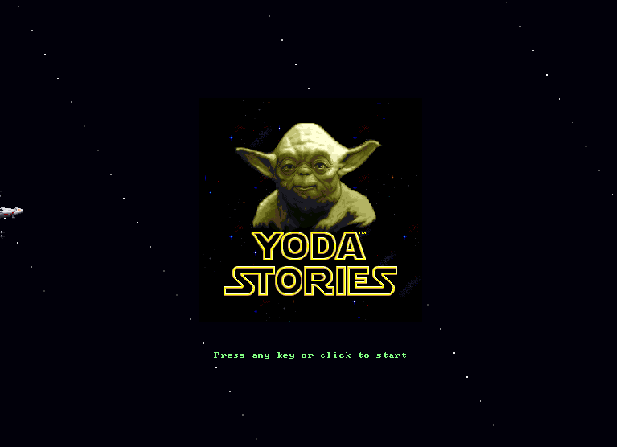
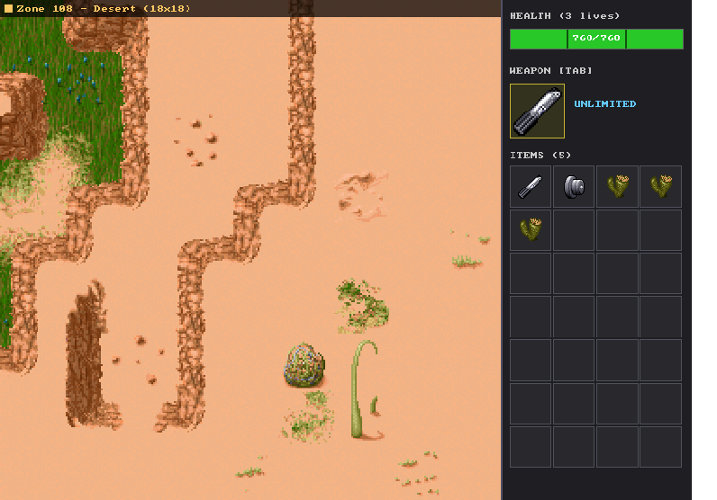
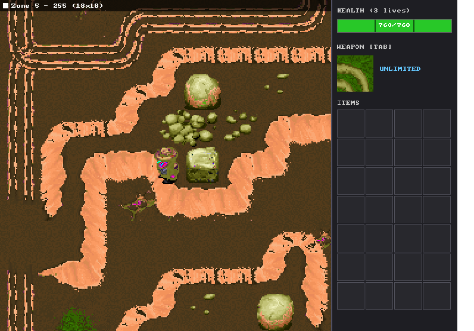
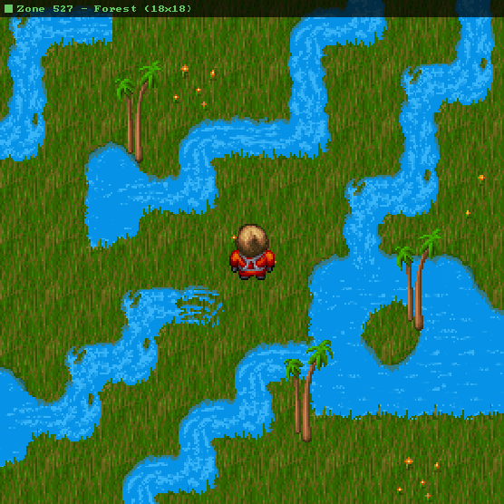

# YODA STORIES NG

[](https://github.com/sp00nznet/YodaStoriesNG/actions/workflows/build.yml)
[](https://github.com/sp00nznet/YodaStoriesNG/releases/latest)

**The 1997 LucasArts desktop toy, rebuilt from its own data file.** Point it at a copy of
*Star Wars: Yoda Stories* or *Indiana Jones and His Desktop Adventures* and it parses the
original tiles, zones, characters and scripts and plays the game - no original executable,
no emulation, no assets in this repository.



*The title screen, rendered from `STUP` in the data file, with the X-Wing flyby assembled at
runtime from tiles 948-951.*

---

## The one reason it exists

**Desktop Adventures generates a new, always-solvable adventure every time you start it**,
and it did that in 1996 in under five megabytes. That generator is the interesting artefact,
and it is locked inside a proprietary container no modern tool reads.

So the point is not nostalgia. It is that `YODESK.DTA` contains a complete procedural
adventure system - a puzzle table, a sector-growth algorithm, and a thirty-eight-opcode
scripting language - and reading it back out is the only way to see how it works.

| | |
|---|---|
|  |  |
| **Yoda Stories** - Tatooine, generated | **Indiana Jones** - same engine, its own palette |

## Where it is

**Yoda Stories is playable end to end.** Fifteen missions, procedural worlds at four sizes,
item-chain puzzles, combat, scoring, save and load. All 36 condition and 38 instruction
opcodes are implemented.

**Indiana Jones generates real missions.** Marcus briefs you in the town, the chain of
trades and puzzle rooms leads to a temple and the artefact - built by a port of the original
world generator, with Indy's own script opcodes and puzzle types decoded from its data (see
[WORLD-GENERATION.md](docs/WORLD-GENERATION.md)). The bot has played one world
from Marcus's briefing to the rescue and the win; other worlds still stop it at puzzles it
has not learned yet - that is the top of the [roadmap](docs/ROADMAP.md).


*Every Indiana Jones run starts here: Marcus names the artefact, hands over the first item,
and the generated chain takes it from there.*

```
2,123 tiles      658 zones      205 puzzles      8,696 scripts      77 characters
```

## Features

What this adds on top of the original, or brings to platforms it never ran on:

- **Both games from one engine** - Yoda Stories and Indiana Jones, detected from the file you
  point it at, each with its own palette, script opcodes and world generator.
- **X-tra Large worlds** - a 15x15 map carrying all fifteen missions at once, alongside the
  original Small, Medium and Large. [PLAYING.md](docs/PLAYING.md#world-sizes)
- **Xbox controller support** - any SDL gamepad, hot-plugged, with analogue movement and
  weapon cycling on the bumpers. [PLAYING.md](docs/PLAYING.md#controller)
- **An in-game pause menu** - save, load, new game, world size, scale, sound and the bot,
  all reachable from a controller without touching a mouse.
- **A hideable menu bar** - put it away on Windows, Linux or macOS and play from the pause
  menu; `F10` brings it back.
- **Windows, Linux and macOS** - self-contained builds for all three, Intel and Apple
  Silicon, with a working menu bar on each.
- **Original sound effects**, played from the game's own WAV files.
- **A mission bot** - press `B` and it plays the game for you.
- **Saves that keep the whole world** - plain JSON, restored exactly rather than
  regenerated, with a built-in editor.
- **Smooth movement** - optional: hero and enemies glide between tiles in eight directions
  with a following camera. Off by default, under Config. [PLAYING.md](docs/PLAYING.md#smooth-movement)
- **1x / 2x / 4x scaling** and rebindable keys.
- **Six debug tools** for pulling the data file apart - see [Look inside it](#look-inside-it).

## How it works

- **One file is the whole game.** A flat sequence of tagged sections - tiles, zones,
  characters, puzzles, scripts, the title art. Parsed once at startup into plain objects.
  [DATA-FORMAT.md](docs/DATA-FORMAT.md)
- **Zone behaviour is data, not code.** Each zone carries IACT scripts: a flat AND of
  conditions, then a flat sequence of instructions. Doors, traps, trades, teleports and the
  win condition are all built out of that. [SCRIPTING.md](docs/SCRIPTING.md)
- **Worlds grow outward and chain backwards.** A sector grid expands ring by ring from the
  spaceport; then the puzzle chain is built *backwards* from the goal, so the world is
  solvable by construction. [WORLD-GENERATION.md](docs/WORLD-GENERATION.md)
- **The water moves because the palette rotates.** No tile data changes and no textures are
  re-uploaded - named colour ranges rotate within themselves on a 150 ms timer. The two
  games animate different ranges, which is why loading one as the other looks subtly wrong.



## Run it

**Prebuilt, self-contained, no runtime to install:**
[Releases](https://github.com/sp00nznet/YodaStoriesNG/releases) - Windows, Linux, macOS
(Intel and Apple Silicon). You still need your own copy of the game:
[GAME-DATA.md](docs/GAME-DATA.md).

From source, with the .NET 8 SDK - drop `yodesk.dta` into `Yoda/` (and `desktop.daw` into
`INDYDESK/`) and `dotnet run --project src/YodaStoriesNG.Engine`. Command-line switches and
publishing are in [BUILDING.md](docs/BUILDING.md).

`WASD` to move, `Space` to act, `O` for the objective, `B` to let the bot play it for you.
**On a controller**, `Start` opens a pause menu that does everything the menu bar does -
and can hide the menu bar altogether, on Windows, Linux and macOS alike (`F10` brings it
back). [PLAYING.md](docs/PLAYING.md) has the rest.


## Look inside it

Six debug tools, all in a normal build - five of them separate windows you can park on a
second monitor. [DEBUG-TOOLS.md](docs/DEBUG-TOOLS.md)

| | |
|---|---|
|  |  |
| **`F3`** IACT disassembly, script coordinates highlighted in the world | **`F4`** all 2,123 tiles, filtered by the flag bits from the file |

`F2` map viewer, `F8` save editor, `F9` zone editor, `F1` in-game overlay, `I` console dump.

## Notes to self

The traps this format sets - five fixed argument slots with no count, a version field that
lies, a zone count you must trust over a marker scan - are written up in
[NOTES-TO-SELF.md](docs/NOTES-TO-SELF.md). Read it before touching the parser.

## Layout

```
docs/                     everything needing more than a paragraph - start at docs/README.md
  hero.gif  shots/        generated by tools/capture-shots.ps1, never by hand (CAPTURING-SCREENSHOTS.md)
src/
  YodaStoriesNG.Engine/     THE GAME - plays both .dta and .daw
    Parsing/DtaParser.cs      the whole file format
    Game/GameEngine.cs        frame loop, input, rules
    Game/WorldGenerator.cs    missions and the backwards puzzle chain
    Game/ActionExecutor.cs    the 74 script opcodes
    Rendering/Palette.cs      256 colours and the animation cycles
    Bot/                      A* mission bot, plays it for you
    UI/                       title screen, HUD, six debug tools
    Dev/                      screenshot harness and the self-test
  IndyNG.Engine/            a minimal .daw parse/palette testbed, not how you play Indy
tools/                    capture harness, SZDD decompressors, palette extractors
```

## Thanks

- **Emilio Castillo** ([@emcastillo](https://github.com/emcastillo)) - Yoda mission-chain and
  X-wing travel fixes, enemy animation frames, smooth movement, weapon attack poses,
  puzzle resets, item targeting, native script and reward fixes, the Locator map, and the
  headless audits that check all of it
  ([#4](https://github.com/sp00nznet/YodaStoriesNG/pull/4),
  [#5](https://github.com/sp00nznet/YodaStoriesNG/pull/5),
  [#6](https://github.com/sp00nznet/YodaStoriesNG/pull/6),
  [#7](https://github.com/sp00nznet/YodaStoriesNG/pull/7),
  [#8](https://github.com/sp00nznet/YodaStoriesNG/pull/8)).

## Legal

Fan project, not affiliated with or endorsed by LucasArts, Disney or Lucasfilm. Star Wars,
Yoda Stories and Indiana Jones are their trademarks. **No game content is in this
repository** - you must own a legal copy of whichever game you load.

Code is [MIT](LICENSE); see [NOTICE](NOTICE) for what that does and does not cover.
File-format work is cross-checked against
[WebFun](https://codeberg.org/cyco/WebFun), without which several of the
[notes to self](docs/NOTES-TO-SELF.md) would still be open bugs.

---

*May the Force be with you.*
