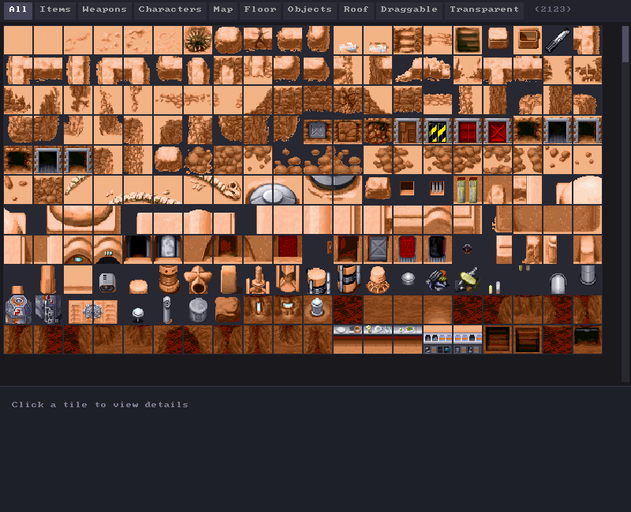

# The Desktop Adventures data file

`YODESK.DTA` (Yoda Stories) and `DESKTOP.DAW` (Indiana Jones) are the same container format
holding the same kinds of data. One file is the entire game: every tile, every zone, every
character, every script, the title image, and the sound file names.

Everything below describes what `src/YodaStoriesNG.Engine/Parsing/DtaParser.cs` actually
does. Where the format was worked out by cross-checking against
[WebFun](https://codeberg.org/cyco/WebFun), the relevant reference file is cited.

**All multi-byte integers are little-endian**, except the two halves of the version number,
which are big-endian. That inconsistency is in the original files, not a mistake here.

---

## The container

A flat sequence of tagged sections, each introduced by a four-byte ASCII tag. Nearly all of
them carry a `uint32` length; two do not.

```
+--------+--------+------------------------------+
| tag    | length | payload                      |
| 4 char | uint32 | `length` bytes               |
+--------+--------+------------------------------+
   ...repeats until ENDF...
```

The exceptions:

- **`VERS`** has no length field. It is always four bytes of payload.
- **`ENDF`** has no length field and no payload. It ends the file.

An unrecognised tag is logged and skipped using its length, so a file with sections this
engine does not know about still loads.

### Section order

| # | Tag | Payload |
|---|---|---|
| 1 | `VERS` | Format version |
| 2 | `STUP` | The title screen image |
| 3 | `SNDS` | Sound file names |
| 4 | `TILE` | Every 32x32 tile |
| 5 | `ZONE` | Every zone. Yoda: with its scripts. Indiana Jones: tiles only, the rest in `ZAUX`..`ACTN` straight after |
| 6 | `PUZ2` | Puzzle definitions |
| 7 | `CHAR` | Characters |
| 8 | `CHWP` | Character weapons |
| 9 | `CAUX` | Character auxiliary data |
| 10 | `TNAM` | Human-readable tile names |
| 11 | `ENDF` | End |

---

## `VERS` - version

Four bytes, two big-endian `uint16`s: major, then minor.

```
00 02  00 00   ->  2.0
```

**This does not identify the game.** Retail `DESKTOP.DAW` also reports 2.0. The engine logs
the version and identifies the game from the file name instead - see
[GAME-DATA.md](GAME-DATA.md#how-the-engine-decides-which-game-it-loaded).

---

## `STUP` - title screen

`length` raw bytes of 8-bit palette indices, 288x288, row-major, no header. Exactly 82,944
bytes for both games.

The engine converts it through the palette into an ARGB texture once, at startup, and it
becomes the title screen background under the flyby animation.

---

## `SNDS` - sound names

A list of file names, not audio. The actual `.wav` files sit next to the data file on disk
(`sfx/` for Yoda Stories, the game directory itself for Indiana Jones). `PlaySound`
instructions index into this list. Indiana Jones stores full paths from its developers'
machines (`\INDY\MASTER\PUSH.WAV`), so only the last component means anything. Four of
its eighteen entries are MIDI music, which the engine does not play.

---

## `TILE` - the tile atlas

The section is a flat array of fixed-size records with no count field - the parser reads
records until the section's byte budget is exhausted.

```
+--------+-------------------------+
| flags  | pixels                  |
| uint32 | 1024 bytes              |
+--------+-------------------------+
   1028 bytes per tile
```

Yoda Stories has **2,123** tiles; Indiana Jones somewhat fewer. Tile IDs are simply the
index in this array, which is why hard-coded IDs such as the X-Wing's 948-951 work at all.

Each pixel is a palette index. **Index 0 is transparent**, which is why no tile uses it as a
colour.

### Tile flags

The `uint32` is a bit field describing what the tile is for. `TileFlags` in
`src/YodaStoriesNG.Engine/Data/Tile.cs`:

| Flag | Meaning |
|---|---|
| `Transparency` | Has transparent pixels; must be drawn with blending. |
| `Floor` | Walkable ground, drawn on layer 0. |
| `Object` | A thing in the world, drawn on layer 1. |
| `Draggable` | Can be pushed and pulled by the player. |
| `Roof` | Drawn on layer 2, above the player. |
| `Map` | Part of the world-map graphic. |
| `Weapon` | Usable as a weapon. |
| `Item` | Collectable into the inventory. |
| `Character` | A character animation frame. |

The Asset Viewer (`F4`) filters the atlas by exactly these flags.



---

## `ZONE` - zones and their scripts

The largest section by far, and the one where the two games differ most. Yoda Stories
keeps everything about a zone in one record. Indiana Jones keeps only the tiles in `ZONE`
and stores the rest in separate sections that follow it (below). Every layout here is
WebFun's (`file-format/categories/zone.ts`), and the parser's totals match an independent
parse of both retail files: 658 Yoda zones and 366 Indiana Jones zones.

```
Yoda Stories                            Indiana Jones
"ZONE"  (no length)                     "ZONE"  uint32 length
count   uint16                          count   uint16
per zone:                               per zone:
  planet   uint16                         IZON
  size     uint32  (bytes after this)
  index    uint16
  IZON
  hotspots
  IZAX, IZX2, IZX3, IZX4
  actionCount uint16, IACT x N
```

The count is exact. The parser reads records by it and stops at the first marker that is
not where the layout says, rather than scanning for markers - an earlier scanning parser
"found" 27 Indiana Jones zones that way and misread most of the rest.

### `IZON` header and tiles

```
"IZON"           4 bytes
size             uint32     (not needed)
width            uint16     (9 or 18)
height           uint16
type             uint32     (ZoneType - Town, Goal, Trade, ...)
sectorCounter    uint16     Yoda only
planet           uint16     Yoda only, repeats the one before IZON
tiles            width x height x 3 uint16, in y, x, layer order
```

**Planet** is Yoda-only and doubles as tile-set identity: `1` Desert (Tatooine), `2` Snow
(Hoth), `3` Forest (Endor), `5` Swamp (Dagobah). There is no 4.

**Type** is what world generation selects zones by. The values run `0` None, `1` Empty,
`2`-`5` Blockade N/S/E/W, `6` TravelStart, `7` TravelEnd, `8` Room, `9` Load, `10` Goal,
`11` Town, `12` (Indiana Jones only, unused by its data), `13` Win, `14` Lose, `15` Use,
`16` Trade, `17` Find, `18` FindUniqueWeapon.

Tile ID `0xFFFF` means "nothing here". An 18x18 zone is 1,944 bytes of grid.

### Hotspots

A `uint16` count, then that many 12-byte records:

```
type       uint32   (ZoneObjectType)
x          int16
y          int16
enabled    uint16
argument   int16    (meaning depends on type)
```

`argument` is a tile ID for an item, a destination zone ID for a door, a character ID for
an NPC.

### `IZAX`, `IZX2`, `IZX3`, `IZX4`

Each starts with its marker and a `uint32` size that counts the eight header bytes.

| Tag | Payload |
|---|---|
| `IZAX` | `uint16` unknown, `uint16` monster count and the monsters, then a counted list of `uint16` required items, then (Yoda only) a counted list of goal items. |
| `IZX2` | A counted list of `uint16` items the zone can provide. |
| `IZX3` | A counted list of `uint16` NPC characters that can appear. |
| `IZX4` | One `uint16`, meaning unknown. |

A monster is 44 bytes in Yoda Stories and 6 in Indiana Jones:

```
character  uint16                          both
x, y       uint16 x 2                      both
loot       int16    tile + 1, 0/-1 = none  Yoda
dropsLoot  uint32                          Yoda
waypoints  int32 x 8                       Yoda
```

When a monster that `dropsLoot` dies it drops tile `loot - 1`, or the zone's quest item if
`loot` is not positive (WebFun `bullet-move.ts`).

### Indiana Jones' per-zone sections

These follow `ZONE`, each with a `uint32` length:

| Tag | Layout |
|---|---|
| `ZAUX` | One `IZAX` per zone, in zone order |
| `ZAX2` | One `IZX2` per zone |
| `ZAX3` | One `IZX3` per zone |
| `ZAX4` | One `IZX4` per zone |
| `HTSP` | `int16` zone id, then hotspots as above; repeats until zone id `-1` |
| `ACTN` | `int16` zone id, `uint16` count, that many `IACT`; until `-1` |
| `ZNAM` | `int16` zone id, 16-byte name ("Cairo"); until `-1` |
| `PNAM`, `ANAM` | Puzzle and action names. Not read. |

### `IACT` - action scripts

This is the one that repays care. The layout:

```
"IACT"                  4 bytes
size                    uint32   (Indiana Jones always writes 0 - trust the counts)
conditionCount          uint16
  condition x N         (see below)
instructionCount        uint16
  instruction x N       (see below)
```

and a condition and an instruction have **identical** layout:

```
opcode                  uint16
argument                int16   x 5      <- ALWAYS five slots, used or not
textLength              uint16
text                    textLength bytes, ISO-8859-2
```

The five fixed argument slots are the trap. They are not length-prefixed and there is no
argument count; an item is always at least 12 bytes. Reading the first slot as a count and
the second as a text length parses without error, produces plausible-looking opcodes, and
is completely wrong - every argument shifts by one and the text length picks up whatever
integer happens to sit in slot 1, so "dialogue" comes back as slices of the following
section headers. That is exactly the bug this parser used to have; it cost roughly 100 zones
to desynchronisation and made every scripted line of dialogue unreadable.

Reference: `webfun-reference/src/engine/file-format/categories/action.ts`.

The opcodes themselves are [SCRIPTING.md](SCRIPTING.md).

---

## `PUZ2` - puzzles

A list of `int16` index (`-1` ends it), `"IPUZ"`, `uint32` size, then:

```
                 Yoda Stories      Indiana Jones
type             uint32            uint32
item1 class      uint32            uint32
item2 class      uint32            -
unknown          uint16            uint16
strings          5 x (uint16 length, text)
item1            uint16            uint16
item2            uint16            -
```

**Type** is `0` Transaction (an NPC trades), `1` Offer, `2` Goal (the steps just before the
end), `3` Mission (the end puzzle a world is built around), `-1` disabled. Yoda Stories has
73/74/43/15 of them; Indiana Jones 49/49/43/15 and one disabled.

WebFun and its Kaitai spec read Indiana Jones' first field as an item class and give every
Indy puzzle no type. It is the type. Every Indy puzzle's `PNAM` name ends in a suffix that
matches it without exception - `TX` 0, `KL` 1, `GW` 2, `GO` 3 - and the 15 `GO` puzzles pair
one-to-one with Indiana Jones' 15 Goal zones.

The strings are what NPCs say: for a Transaction, `0` is "I need X" and `1` the thanks; `2`
is the giver's offer; a Mission's `2` is the briefing ("Find the JAGUAR CODEX, Indy!").

These are the raw material the world generator chains together into a mission. See
[WORLD-GENERATION.md](WORLD-GENERATION.md).

---

## `CHAR`, `CHWP`, `CAUX` - characters

`CHAR` defines each character: name, type (hero, enemy, friendly), and three animation
frames, each containing eight tile IDs. The renderer uses slots 0, 1, 3, and 6 for up,
down, left, and right. Slots 2, 4, 5, and 7 hold their adjacent-tile extensions.
For weapon characters, frame 0 contains projectile sprites and the inventory icon in
slot 7; frames 1 and 2 contain the hero's attack poses and their weapon extensions.
Yoda Stories has 77 characters.

`CHWP` and `CAUX` are lists keyed by character index, not arrays in character order. Each
entry starts with an `int16` index, and an index of `-1` ends the list:

| Section | Entry after the index |
|---|---|
| `CHWP` | `int16 reference`, `uint16 health` |
| `CAUX` | `int16 damage` |

`reference` means two different things. On an enemy it is the index of the weapon
*character* that enemy fires (every Stormtrooper points at "Imperial Blaster"). On a weapon
character it is the `SNDS` index of the sound that weapon makes. `-1` means none.

`CHAR` records are not a fixed size either: each one is `"ICHA"` plus a `uint32` size.
Yoda Stories has six more bytes before the animation frames than Indiana Jones does. The
last slot of a weapon character's first frame is the inventory tile it is equipped from.

---

## `TNAM` - tile names

Maps tile IDs to human-readable names ("Lightsaber", "Bacta Tank"). Every dialogue line and
debug view that names an item reads from here. Not every tile has one.

A list of `int16` tile id (`-1` ends it) and a NUL-padded name in a fixed-width field: 24
bytes in Yoda Stories (246 names), 16 in Indiana Jones (143).

---

## Reading it yourself

The fastest way to see any of this is `--diag`, which parses and reports without opening a
window:

```bash
dotnet run --project src/YodaStoriesNG.Engine -- --diag
```

For a live view, the Asset Viewer (`F4`) browses tiles by flag and the Script Editor (`F3`)
disassembles IACT scripts zone by zone. Both are in [DEBUG-TOOLS.md](DEBUG-TOOLS.md).
