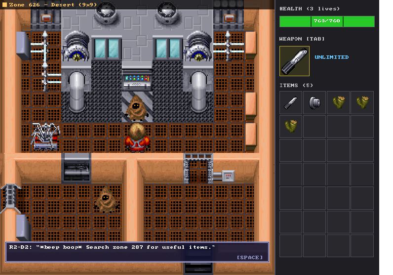
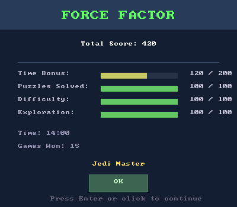
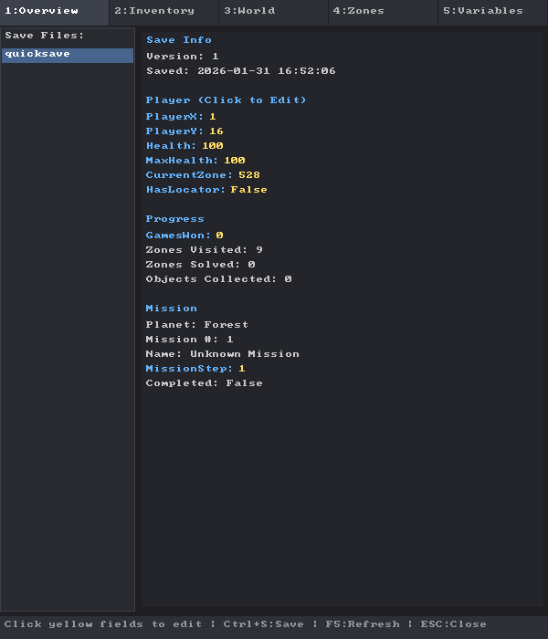

# Playing

A guide to the game as this engine implements it: how to control it, what the fifteen
missions are, how scoring works, and where your saves go.

If you have never played a Desktop Adventure: it is a small top-down action-adventure that
generates a fresh world every time. You wander a grid of screens, solve item-trade puzzles
with the people you meet, hit things that need hitting, and finish a mission. Then it
generates another one.

---

## Your first game, step by step

1. **Start it.** `dotnet run --project src/YodaStoriesNG.Engine`
2. **Dismiss the title screen.** Any key, or click.
3. **Look at the sidebar on the right.** Health at the top, current weapon in the middle,
   your eight-by-seven inventory grid below. It is empty. It will not stay empty.
4. **Press `O`.** The current objective prints as a message - what you are looking for and
   roughly where.
5. **Walk.** `WASD` or the arrow keys. One tap is one tile. Enable **Config → Smooth Movement** to glide between tiles and move diagonally.
6. **Press `F` if the zone is dull.** It jumps you to the next zone that actually has NPCs
   or items in it. This is a debug shortcut, and it is the fastest way to see the game
   working.
7. **Walk into a person to talk to them.** They will tell you what they want. If you have
   it, they trade. That trade is the puzzle.
8. **Press `Space` to use the selected item or swing the selected weapon.** Direction
   comes from the way you are facing.
9. **Press `1`-`8` to pick an inventory slot**, or click a slot directly. Mouse wheel over
   the sidebar scrolls a long inventory.
10. **Find the X-Wing and press `X`** to travel between the starting swamp and the mission
    planet. Indiana Jones uses a different vehicle in the same role.
11. **Stuck?** Press `O` again, or - once you have R2-D2 - let R2 tell
    you where to go next.

The **Locator** is a separate map item. Select it and press `Space` (controller: `A`)
to open the world map. Gameplay pauses while the map is open. Close it with `Escape`,
`Space`, the window close button, or controller `A`/`B`. R2-D2 gives hints instead.

To use a puzzle item, stand next to the target and either drag the item from the bag
onto that map tile (including a diagonally neighboring tile), or select it and press
`Space` while facing the target. A puzzle
target directly underneath Luke can also be used with `Space`. Dropping an item out
of reach shows a message and keeps it in the bag. During smooth movement, item use
waits until Luke reaches the next tile center.



---

## Movable puzzle objects

Moved blocks, boulders, and other puzzle objects stay where you leave them when you
leave and revisit an area. Local puzzle progress is preserved, including in unsolved areas.
Starting a new game restores all areas to their original state before generating the new world.

## Smooth movement

Enable **Config → Smooth Movement**, or **Smooth Movement** in the controller pause menu.
The choice is remembered between launches and is off by default. It applies to both the
player and enemies. Hold movement keys or the D-pad to keep walking; two directions move
diagonally, and the analog stick controls walking speed. Releasing input finishes the
current tile step. Diagonals have the same overall speed. Luke can pass through diagonal
openings between wall corners and movable rocks when the destination is clear;
actors and reserved movement cells still obstruct them.
Walking toward an opening also slides Luke around the wall corner.

Pushing, pulling, boarding, and entering doors use a cardinal approach. Actions requested
while walking happen at the next tile center. A mode change takes effect when active
steps finish. Saves keep committed tile positions, so loading starts at a tile center.

## Keyboard

### Playing

| Key | Action |
|---|---|
| `W` `A` `S` `D` / arrow keys | Move one tile. Walking into a pushable block pushes it. |
| `Shift` + direction | Pull an adjacent block by stepping away from it. For a block on your right, hold `Shift` and move left. |
| `Space` | Use the selected item, talk to whoever is in front of you, or attack. |
| `Tab` | Cycle to the next weapon. |
| `1`-`9`, `0` | Select inventory slot 1-10, relative to the current scroll position. |
| `[` / `]` , `PgUp` / `PgDn` | Scroll the inventory list. |
| `O` | Print the current mission objective. |
| `X` | Board the X-Wing and travel. Only works where a vehicle is parked. |
| `M` | Mute or unmute sound. |
| `R` | Abandon this world and generate a new one. |
| `Esc` | Quit. |

### Debug and tools

| Key | Action |
|---|---|
| `F1` | Debug overlay (arrow keys change tab and scroll, `Esc` closes). |
| `F2` | Map Viewer window. |
| `F3` | Script Editor window. |
| `F4` | Asset Viewer window. |
| `F5` / `F6` / `F7` | Window scale 1x / 2x / 4x. |
| `F8` | Save Game Editor window. |
| `F9` | Zone Editor window. |
| `B` | Toggle the mission bot - it plays for you. |
| `F` | Jump to the next zone containing NPCs or items. |
| `N` / `P` | Next / previous zone by ID. |
| `I` | Dump the full game state to the console. |

All of these are covered in detail in [DEBUG-TOOLS.md](DEBUG-TOOLS.md).

Bindings are stored in `%APPDATA%/YodaStoriesNG/keybindings.json`
(`~/.config/YodaStoriesNG/` on Linux and macOS) and can be edited there.

---

## Controller

Any SDL2-recognised gamepad works; the layout is written for an Xbox pad. Plug it in at any
time - the engine picks it up and says so on screen.

| Input | Action |
|---|---|
| D-pad | Move |
| Left stick | Move (analogue, repeats while held) |
| `A` | Use item / talk / attack |
| `B` | Dismiss dialogue |
| `X` | Travel |
| `Y` | Show objective |
| `LB` / `RB` | Cycle weapon |
| `Start` / `Back` | Pause menu |
| Any button | Start the game from the title screen |

**The pause menu** is the controller's way into everything the menu bar does. It pauses
the game and offers Resume, Save and Load, New Game, and toggles for world size, graphics
scale, sound, the mission bot and the menu bar, plus Controller Controls, High Scores and
Quit. The
D-pad or left stick moves, `A` picks, `B` or `Start` closes it. The arrow keys, `Enter`
and `Esc` work too.


There is no controller binding for the debug tools. Use the keyboard.

---

## The menu bar

Every platform gets the same four menus.

| Menu | Contents |
|---|---|
| **File** | New Game at each of the four world sizes; Save Game; Save As...; Load Game; Exit |
| **Debug** | Asset Viewer (F4), Script Editor (F3), Map Viewer (F2), Save Editor (F8), Zone Editor (F9), Enable/Disable Bot |
| **Config** | Graphics scale 1x/2x/4x, Keyboard Controls, Controller Controls, Select Data File... |
| **About** | About, High Scores |

Windows draws them with a real native menu bar, outside the window at the OS's own DPI
(`UI/NativeMenuBar.cs`). That is user32, which Linux and macOS do not have, so there they
are drawn by SDL into a strip the window reserves above the game (`UI/MenuBar.cs`) - it
takes no gameplay area, and the menus behave the same way: click a title to open it, drag
along the bar to move between them, `Esc` or a click elsewhere to dismiss. The keyboard
works too, as it does on Windows: `F10` opens the bar, the arrows move through it, `Enter`
picks an item.

**Playing with a controller?** Config -> Hide Menu Bar puts the bar away on every
platform, and on Linux and macOS the window shrinks to just the game. Everything it offered
is in the controller's pause menu, which also has a Menu Bar toggle; `F10` brings it back
too. The choice is remembered.

**No GPU is fine.** A machine with no accelerated render driver - a VM, remote X, a bare
Linux box - gets SDL's software renderer instead of a window that refuses to open.

**Save As, Load Game and Select Data File need a file picker**, and off Windows the game
asks the desktop for its own: `osascript` on macOS, `zenity` or `kdialog` on Linux,
whichever is installed. On a machine with neither, those three items say so and do
nothing - Save Game still works, since it writes `quicksave.ysng` without asking, and
the data file can always come from the command line:

```
./YodaStoriesNG.Engine /path/to/YODESK.DTA
```

That path is matched case-insensitively, so `YODESK.DTA` straight off the disc is found on
a case-sensitive filesystem.

---

## World sizes

Chosen from **File → New Game**. Size changes the grid, the number of puzzles you must
chain together, and the scoring curve.

| Size | Grid | Puzzles | Feel |
|---|---|---|---|
| Small | 10x10 | 4-8 | Twenty minutes. |
| Medium | 10x10 | 6-12 | The default. |
| Large | 10x10 | 8-16 | A proper session. |
| X-tra Large | 15x15 | 12-24 | All fifteen missions on one map. |

How that grid becomes a world is [WORLD-GENERATION.md](WORLD-GENERATION.md).

---

## The fifteen-mission cycle

A full run is fifteen missions. Each one picks a goal puzzle from the game's puzzle table,
works backwards to build a chain of item trades that reaches it, and scatters that chain
across the world. Finishing a mission advances a counter that persists across new worlds
until you complete all fifteen, at which point you get scored.

Missions are drawn without replacement, so a full cycle shows you fifteen distinct goals
rather than the same three repeatedly.

---

## Scoring



At the end of fifteen missions you get a **Force Factor** (Yoda Stories) or **Indy
Quotient** (Indiana Jones) out of 500, from four components:

| Component | Max | How it is earned |
|---|---|---|
| Time Bonus | 200 | Full marks under `5 x world-size-number` minutes, then -20 per further minute. Medium gives you 10 free minutes. |
| Puzzles Solved | 100 | Percentage of the world's puzzle sectors you actually solved. |
| Difficulty | 100 | Currently mirrors Puzzles Solved. |
| Exploration | 100 | Zones visited against `world-size-number x 10` expected. |

The exact arithmetic is `GameState.CalculateScore()` in
`src/YodaStoriesNG.Engine/Game/GameState.cs`.

| Score | Yoda Stories | Indiana Jones |
|---|---|---|
| 450+ | Legendary Hero! | Master Archaeologist! |
| 400-449 | Jedi Master | Professor of Antiquities |
| 350-399 | Jedi Knight | Seasoned Explorer |
| 300-349 | Padawan | Field Researcher |
| 250-299 | Force Sensitive | Museum Curator |
| 200-249 | Adventurer | Graduate Student |
| below 200 | Beginner | Amateur |

Scores are kept in `%APPDATA%/YodaStoriesNG/highscores.json` and shown under
**About → High Scores**.

---

## Saving

Saves are JSON, extension `.ysng`, written to:

| Platform | Location |
|---|---|
| Windows | `%APPDATA%\YodaStoriesNG\saves\` |
| Linux | `~/.config/YodaStoriesNG/saves/` |
| macOS | `~/.config/YodaStoriesNG/saves/` |

**File → Save Game** writes `quicksave.ysng`. **Save As...** lets you name it.

A save carries the whole world, not just your position: player state and inventory, the
generated world map and its zone connections, mission progress and the puzzle chain, every
zone variable and counter, and the set of objects you have already collected. Loading a
save restores the world exactly - it does not regenerate it.

Because it is plain JSON you can open a save in any text editor. Or use the built-in editor
(`F8`), which is friendlier and can add items to your inventory - see
[DEBUG-TOOLS.md](DEBUG-TOOLS.md#save-game-editor-f8).



### Spare weapons

Each weapon pickup adds a copy to your inventory without changing the equipped weapon.
Extra copies remain in the bag when that weapon is equipped. When its ammunition runs
out, one spare is consumed and its full ammunition supply becomes available. Switching
weapons moves one copy between the bag and weapon slot; it does not create extra copies.


### Bot world planning

For generated Yoda Stories and Indiana Jones worlds, the bot builds a live graph
of outdoor connections, rooms, vehicles, and puzzle item dependencies. Each travel
edge contains its next executable action (walk to an edge, enter a passage, or board
a vehicle). Puzzle nodes include required items, rewards, and the current interaction
target where one is available. The planner follows reward dependencies from the goal,
including both Yoda item branches, and replans from actual game state.

Local navigation still handles combat, pickups, blocked paths, switches, and movable
objects. The graph describes zone connectivity; it does not prove that every route
through an area's terrain or every scripted puzzle can be solved. Existing exploration
is retained when no dependency action can currently be resolved.

The bot computes each local walking route with A* before following its waypoints.
Walking routes avoid solid middle-layer tiles, blocking actors, and movable blocks; moving a block
requires a separate puzzle action. With Smooth Movement enabled, the bot waits for each
step to finish before checking arrival, so an in-progress step is not mistaken for a
blocked tile. Routes are recalculated when an actual move fails.

If a hostile enemy occupies the next waypoint, the bot interrupts walking to attack
that enemy, then replans its mission objective. It first tries routes around enemies;
when enemies seal every route, it can plan toward a blocker and fight on reaching it.
Friendly NPCs remain obstacles and are never attacked to clear a route.

Local routes avoid unrelated doors, teleporters, vehicle hotspots, and scripted
boarding/warp cells. Only the explicitly selected transition is permitted as a travel
target. The bot checks the next waypoint again before moving, since scripts can
enable a transition after the route was calculated.

While the bot is enabled, gameplay continues when the main window loses focus.
Background keyboard/controller movement is ignored. Explicit pause and open gameplay
menus still pause the simulation; manual play retains its normal focus behavior.

Item-use completion is checked against actual inventory. If a consumed puzzle item
has an expected reward that is not yet held, the bot keeps a follow-up collection
objective and looks for physical drops, hotspots, or actionable reward scripts.
The bot follows mission prerequisites and their planned routes. It does not try arbitrary
inventory items on friendly NPCs, collect unrelated loot, visit unrelated rooms, or use
random movement for recovery. Combat targets mission prerequisites, actual route
blockers, and adjacent hostiles for defense. Replanning retries are bounded; if no
executable instruction remains, it saves a full diagnostic snapshot and stops.

### Object-puzzle planning

When objects obstruct a repeated objective, the bot searches a copy of the current
area for a push/pull solution before moving anything. Each search state includes
the block positions and the player's reachable walking space. It can clear a route
or match draggable-tile placements described by native `TileAtIs` conditions, then
walk onto the required switch/target.

The bot retains the resulting sequence and checks the expected map layout before
each action. Changed layouts invalidate the sequence. Object actions also check the
player's standing position and wait for smooth movement to finish. Searches are
bounded to 12,000 states; complex puzzles and script effects not represented by
these map conditions may still require planner improvements or player input.

Combat follows an explicitly selected enemy throughout the current area; a distant
target is approached with A* rather than discarded at an arbitrary distance limit.
If no safe approach exists, that enemy is deferred until the map, inventory, or actor
positions change. Known visible quest rewards remain collection targets so stale
path failures do not hide them from object-puzzle planning.

World routing tracks reachable walking components within each area, starting from
the predicted entrance. It checks both sides of outdoor crossings and the landing
cell, and passes the chosen crossing coordinate to the local navigator. A route
therefore cannot assume that entering one side makes every exit reachable.
Blocked exits are remembered for the current component and layout; changed terrain,
actors, or inventory allow reconsideration. Scripted arrivals are inferred from
authored door counterparts or landing instructions and rechecked after actual travel.

Item-use routing also checks the interaction cell's reachable neighbors, not merely
its zone ID. It can leave and re-enter the same zone through a different component
when the world provides a valid route. Failed item targets invoke block planning
before deferring the unchanged target, rather than repeatedly issuing the same use.

Route selection works backward from the destination's target-reachable components.
Puzzle interactions supply their adjacent action cells; item collection supplies the
item's own cell. Reverse search follows real directed transitions to select a chain
of usable entrances and exact crossings back to the player's current component.
It does not assume that a doorway or vehicle can be traversed in both directions.

Rewards under objects use reachable manipulation neighbors as acceptable room-entry
goals; the bot does not require the covered item cell to be walkable before entering.
Closed doors are bumped first, then entered after their opening script completes.
These actions do not grant rewards or bypass the native puzzle scripts.

Terrain-blocked exits remain blocked when unrelated enemies move. Failed chest/reward
bumps remain available to object planning. Switch arrangements must connect to the
objective's reward or target cell; the bot does not try arbitrary switches or shifts.
A 45-second watchdog stops the bot if it discovers no new mission-progress state
(inventory, solved areas, visited areas, disabled scripts, changed layouts, or enemy health), even if it keeps walking
or completing ineffective actions. The diagnostic reports the zone and last objective.

### Sharing bot debug logs

Enabling the bot starts a new folder under the save directory's `bot-debug` folder.
The terminal prints the full path to `actions.log`, then gameplay/bot output is
written there while the bot runs. Paste the relevant section or attach that file
when reporting a problem. `latest-session.txt` identifies the newest session folder.

The readable log includes every requested action and its result, objectives, inventory,
waypoints, failed-path neighbors, zone changes, script instructions and arguments, and
progress/recovery events. `events.jsonl` contains structured versions of these events.
`snapshot-*.json` files capture the initial world and
current-area details on zone changes, failures, getting stuck, and stopping; attach
these when the text log is insufficient. Logging errors restore terminal output and
do not stop gameplay. Normal terminal output returns when the bot stops.

If a reward marker lies inside a static wall and its actual scripted source is no
longer actionable, the bot reports an unresolved reward instead of repeatedly
leaving and re-entering the room. It saves a full-world snapshot labeled
`unresolved-reward` with the item, source room, and counter for investigation.

Scripted transports distinguish the boarding bump from the hidden transit marker.
The planner follows active counter/random guards to find an unlocked boarding action
and does not request its spent payment again. A flight's final scripted relocation
onto the vehicle marker triggers travel through the normal engine transition.
Unreachable incidental loot no longer interrupts the mission route on every visit.

### Reproducing a generated world

Start with a signed 32-bit seed, before or after the data path:

```sh
dotnet run --project src/YodaStoriesNG.Engine -- Yoda --seed 12345
```

`--seed=12345` also works. The command-line value overrides `YSNG_SEED`.
Without either, each new world receives a random seed. The effective seed, planet,
and world size are written into `actions.log` when the bot starts and into debug
snapshots. Use the same data file, world size, and build to reproduce the world.
A fixed seed deliberately regenerates the same world on each New Game.

Planet selection, generator retries, auxiliary placements, and per-zone script dice
derive from the seed. This reproduces generated layouts and zone dice, not the exact
frame-by-frame combat or bot timing. Saves retain the seed and zone-roll counts;
older saves without a seed remain loadable and report that their seed is unknown.

Reward-source planning considers native monster-death prerequisites before declaring
a scripted reward unavailable. A pending fight is not treated as a missing item.

Automatic companion collection is limited to reachable R2 units on Dagobah; an R2Unit
elsewhere is handled by its native puzzle role. Optional conversations exclude NPCs
beyond static walls. If a reward chest is created by a script only after its tile
is cleared, the bot explicitly plans to move the covering block before opening it.

### Defeated enemies and loot

Defeated native monsters retain their identity across area revisits, so leaving and
returning cannot respawn them and award the same loot again. Their dead entries remain
available to indexed puzzle conditions. Saves retain this defeated-state list; older
saves default to an empty list, and New Game clears it. Existing duplicate inventory
entries in older saves are preserved because multiple copies can be legitimate rewards.

### Scripted passages within an area

The route graph includes directed passages whose active `StandingOn` script relocates
Luke inside the same area. Counter/random guards and the trigger's current floor tile
must match. The bot walks onto the selected trigger, lets the native travel sequence
run, then replans from its authored arrival point. Other passage triggers remain
excluded from ordinary walking routes. For example, zone 66's lock opens access to
its passage at (7,7), which carries Luke to (7,3) before he continues north.

Both A* walking and world-component planning include diagonal tile-step connections
even with Smooth Movement disabled. The bot prefers cardinal movement, but retains
diagonal-only cave corridors. Smooth movement applies its additional side-cell
collision rules; tile-step navigation uses the existing atomic movement handler.
Hostile actors do not split
the strategic graph into permanently disconnected areas: walking still stops for an
actual blocker, and melee combat can hit an enemy diagonally adjacent to Luke.
Doorway entry, pushing, and pulling remain cardinal. Item placement can target any of the eight neighboring tiles, independently of Smooth Movement.

When an item-use script opens a passage by clearing its entrance, the bot retains
entering that passage as the continuation of the same operation. This is matched
against the native item-use and standing-trigger scripts; it does not select an
unrelated doorway when the complete mission route is still blocked farther ahead.

Mission planning considers independent missing requirements before giving up on a
blocked branch. If an unvisited area on the dependency route has first-entry scripts,
the bot can plan the known route into it, let the native initializer run, and replan
the final interaction using the resulting map. It does not require an untouched
room template to already expose every door or NPC approach.

Authored standing-trigger passages may require a diagonal approach. Only the selected
passage trigger is authorized; unrelated travel triggers remain excluded. Actual door
hotspots, X-wings, and object pushes/pulls retain cardinal approaches. Item-use targets also allow diagonal neighboring positions.

Object-solution searches use the same walking neighbors as ordinary A*, applied to
each simulated block arrangement. Diagonal walking is available between
cardinal pushes and pulls. Hostiles do not permanently invalidate a block solution:
if one occupies a required standing, retreat, or block-landing cell, the bot selects
that enemy for combat before resuming the queued moves. Friendly actors remain blockers.
Inactive alternative bump targets do not forbid diagonal walking through an empty cell.

Covered doorways participate in mission routing. For the current reachable area,
the graph can use a bounded object solution to establish that an entrance can be
cleared. Execution clears the blocks before entering, instead of repeatedly bumping
the covering rock. Only the selected doorway is authorized as a travel target during
that search. Results are shared within one planning decision. Object arrangements
use a goal-directed best-first queue, with a fast rejection when permanent terrain
would block the target even after removing every movable object.

Blocked mission routes select gates that separate the player from the requested
outdoor destination, rather than the nearest unsolved sector. Native script state
must still expose an item-use target for that gate. Its missing key becomes a
fetch dependency, including a staged visit to an unvisited object-puzzle area.
Scripted same-area passages support both standing triggers and cardinal bumps;
the native tile/counter/random guards and authored arrival position remain authoritative.

Zone-exit retries count actual outward movement requests from the exact boundary.
Walking toward the edge or fighting an enemy does not count as a failed crossing.
The bot waits for movement to finish and allows a response interval before retrying;
combat, position changes, and zone replacement clear stale exit tracking. Debug logs
record each `exit-request` and timed-out `exit-rejected` with its attempt number.

Covered scripted chests use an explicit clearance goal: remove the covering block
and retain a cardinal approach for opening the chest. The planner does not ask Luke
to walk onto the chest square. Its search uses corridor distances through permanent
terrain and reuses each arrangement's walking component. Planning duration is logged
as `planning-finished` and excluded from the following gameplay update, so computing
a route cannot exhaust the inactivity timeout or fast-forward nearby enemies.
Wandering NPCs are temporary obstacles during object planning. The executor retains
the solution and waits if a friendly occupies a required block stance, landing, or
pull-retreat cell. Stationary and animation-only friendlies remain planning blockers;
hostiles still require combat. Waiting does not reset the mission inactivity limit.

### Headless bot runs

Run the real engine simulation without creating a window, renderer, audio device,
or controller session:

```sh
dotnet run --project src/YodaStoriesNG.Engine -- Yoda --headless-bot --seed 12345 --smooth --speed 20 --bot-seconds 1800
```

`--speed 20` targets twenty simulation seconds per wall-clock second, subject to CPU
and planning time. `--speed 0` removes throttling. Both run ordinary 1/60-second
simulation steps; neither enlarges movement or script timesteps. The bot always
executes exact tile steps; `--smooth` enables enemy interpolation for this run. `--world-size Small|Medium|Large` defaults to Medium.
`--bot-seconds` limits simulation time and defaults to 1800 (maximum 86400).
`--bot-log-dir PATH` changes the log root; the normal bot-debug folder is the default.
Headless runs do not change the player's settings.

The runner exits on a bot stop, game over, mission completion, time limit, or Ctrl+C.
It writes the normal action/event logs and stop snapshot, plus `run-summary.json`
with simulation time, wall time, planning time, seed, movement mode and exit reason.
Exit codes are 0 for mission completion, 1 for a bot stop/game over, 2 for invalid
arguments, 3 for the simulation time limit, and 130 for cancellation.

A route can also require object preparation in an already visited area beyond a
scripted passage. When the full route is blocked, the graph searches reachable
entrance components for a proven block solution that opens a crossing toward the
objective. It first follows real travel edges to that component, then replans and
executes the object solution against the live map. A failed route does not justify
entering an unrelated area or assuming that a block has already moved.

Covered quest rewards use the same arrangement solver as scripted chests, including
movable furniture in indoor rooms. The bot does not abandon a reward merely because
the covering object's first push or pull has no reachable stance. Future goal-room
approaches may be staged after proving an object solution from the room's entry.

Finale planning follows authored win-condition dependencies when the generated
sector's primary item exchange is not yet available. Additional required items
can unlock an entrance first. Item drops and required tile/counter changes are traced
back to their scripted producers; unsupported guards fail conservatively. Authored
cross-zone bump/standing entrances retain exact arrivals and required approach
squares, including scripted arrivals on door tiles from which Luke must step away.

The action graph also retains every native script in each discovered room under
`Scripts`: zone and action index, disabled state, conditions and instructions.
Script-only room destinations are discovered even when their entrance guards are
not currently satisfied. Script visibility is separate from executable planning:
an unsupported condition remains visible and is not assumed to succeed.

Final-room approach planning can identify prerequisites across connected rooms,
including a bump that sets a signal consumed by a separate room-change action.
It searches a private relaxed map to select the next door or switch prerequisite,
then resolves that prerequisite through native scripts against the live map.
The relaxed map is never installed as game state. Monster-death guards select the
specified enemy or its scripted activation prerequisite rather than unrelated combat.

Preparation stays focused on a selected one-time arrival action until its native
script completes, so mutually exclusive switch settings do not make the bot
alternate between unfinished plans. Available routes take priority over scripted
shortcuts that still need an item or tile change. A quest item consumed by a
completed finale script is not fetched again; planning continues toward the
remaining authored win condition. Watchdog progress includes script-referenced
floor switches and counters, while repeated configurations still time out.

Strategic room/zone routing shares the engine's middle-layer and scripted-actor collision
checks with movement execution. Initializer staging stays on a shortest zone route,
apart from explicit scripted connectors which return to another component. Locked
walk-on vehicles do not become travel edges until their boarding tile is clear.
Scripted rewards retain their required standing positions and can route through a
different entrance to reach the interaction's component. A bump objective sends the
action-button interaction rather than assuming the target tile blocks movement.

Object preparation can also satisfy a native placement script whose tile moves
open a route to the objective. The planner previews supported guards and tile effects
on a private board before choosing that arrangement; the real engine executes the
script. Hostile actor pictures are clearable combat obstacles in that search, while
stationary friendly actors remain blocked. Finale item dependencies can extend into
their generated source encounters, including native health requirements.

### Resume a headless replay

Headless runs automatically write compressed `checkpoint-NNNN.json.gz` files in
the session log folder, every 30 simulation seconds and after zone changes when
movement, dialogue, attacks, and scripts are idle. These contain the full mutable
world, native actors, inventory, script flags, random roll counters, mission state,
and door return points. Unlike diagnostic snapshots, each checkpoint stands alone.

```sh
dotnet run --project src/YodaStoriesNG.Engine -- Yoda --headless-bot --bot-resume /absolute/path/checkpoint-0020.json.gz --smooth --speed 0 --bot-seconds 1800
```

The checkpoint supplies the seed and world size; use the same game data file.
`--bot-seconds` is the additional simulation budget. Resuming starts a fresh bot
plan without repeating zone-entry scripts. This is a debugging restart from saved
game state, not an exact replay of the old planner's internal decisions or future
random enemy movements. Keep complete runs from the original seed for final
regression validation. Data hashes and checkpoint versions are checked on load.

### Bot movement and the Smooth Movement setting

The bot executes exact tile steps so that a planned route or block move cannot be
changed by automatic corner sliding. Your Smooth Movement preference is preserved
and applies again to manual control when the bot stops. Enemy interpolation continues
to follow that preference. Solid object tiles block movement even when their artwork
contains transparent pixels; a transparency flag is not a collision exemption.
