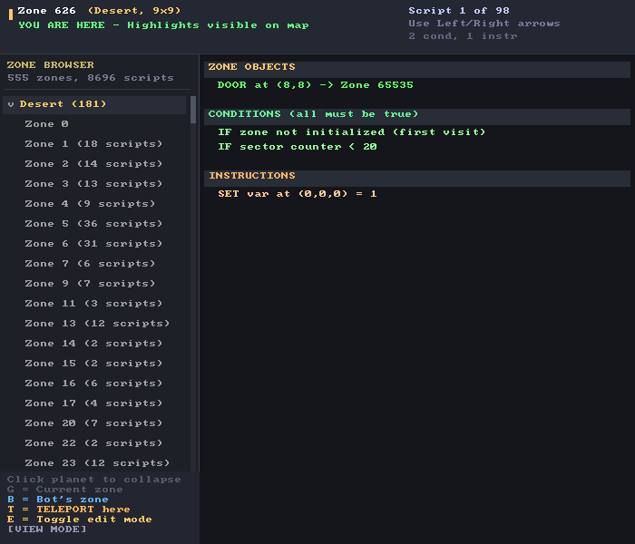

# IACT scripts

Zone behaviour is data. Every zone carries a list of **actions**; an action is a set of
**conditions** and a set of **instructions**. Each frame, for the zone the player is in, the
engine walks the actions and runs the instructions of every action whose conditions all
pass.

That is the whole model. No loops, no branches, no expressions - a flat AND of predicates
followed by a flat sequence of effects. Everything the original game does with doors,
traps, NPC trades, teleports, cutscenes and win conditions is built out of it.

```
ACTION
├── CONDITION  ZoneNotInitialized
├── CONDITION  SectorCounterIsLessThan 20
└── INSTRUCTION SetVariable (0,0,0) = 1
```

The implementation is `src/YodaStoriesNG.Engine/Game/ActionExecutor.cs`. The binary layout
is in [DATA-FORMAT.md](DATA-FORMAT.md#iact---action-scripts).

---

## Reading scripts in the game

Press `F3`. The Script Editor lists every zone that has scripts, disassembles the selected
one into readable conditions and instructions, and marks the coordinates a script touches in
the world.



A healthy Yoda Stories file yields around 8,700 scripts across 555 zones. If you are seeing
far fewer, or seeing dialogue that reads like fragments of section names, your parser is
misaligned - see the [warning below](#the-five-argument-trap).

---

## The five-argument trap

Read this before touching anything that reads or writes IACT data.

**Every condition and every instruction carries exactly five `int16` argument slots**,
whether the opcode uses them or not. There is no argument count in the file. The slots are
followed by a `uint16` text length and that many bytes of text.

```
opcode      uint16
arg0..arg4  int16 x 5      <- always five
textLength  uint16
text        textLength bytes, ISO-8859-2
```

Reading slot 0 as an argument *count* and slot 1 as the text length is the natural mistake,
and it is a quiet one: the file still parses, opcodes still look sane, and the game still
mostly runs. What actually happens is that every argument shifts by one, text lengths come
from whatever integer sat in slot 1, and dialogue comes back as slices of the following
section headers. This engine shipped that bug for a long time - it cost about 100 zones to
stream desynchronisation and made every scripted line unreadable.

There is a check that will fail if it ever comes back:

```bash
dotnet run --project src/YodaStoriesNG.Engine -- --self-test
```

It builds a data file by hand with known values in known slots and asserts they come back
where they went in. `src/YodaStoriesNG.Engine/Dev/SelfTest.cs`.

**Argument order is per-opcode and not always obvious.** Most tile opcodes are
`(x, y, layer, tile)`. Two conditions - `TileAtIs` and `IsVariable` - put the tile or value
in slot 0 and the position in slots 1 to 3. The tables below give the real order for each.

---

## Conditions

36 opcodes, `0x00` to `0x23`. All are implemented.

| Op | Name | Arguments | Passes when |
|---|---|---|---|
| `0x00` | `ZoneNotInitialized` | - | This zone has not been initialised. True exactly once; the standard way to run one-time setup. |
| `0x01` | `ZoneEntered` | - | The hero just entered this zone. |
| `0x02` | `Bump` | x, y, tile | The hero walked into the tile at (x, y) and it is `tile`. |
| `0x03` | `PlacedItemIs` | x, y, layer, tileA, tileB | The player dropped an item onto (x, y, layer) and it matches. |
| `0x04` | `StandingOn` | x, y, tile | The hero is at (x, y) and the floor there is `tile`. |
| `0x05` | `CounterIs` | value | The zone counter equals `value`. |
| `0x06` | `RandomIs` | value | The zone random equals `value`. |
| `0x07` | `RandomIsGreaterThan` | value | Zone random > `value`. |
| `0x08` | `RandomIsLessThan` | value | Zone random < `value`. |
| `0x09` | `EnterByPlane` | - | The hero arrived by vehicle rather than on foot. |
| `0x0A` | `TileAtIs` | **tile**, x, y, layer | The tile at (x, y, layer) is `tile`. **Note the order.** |
| `0x0B` | `MonsterIsDead` | index | Monster `index` in this zone is dead. |
| `0x0C` | `HasNoActiveMonsters` | - | No enabled living monsters remain. |
| `0x0D` | `HasItem` | tile | The inventory contains `tile`. `-1` means the zone's own puzzle item. |
| `0x0E` | `RequiredItemIs` | tile | The zone's required item is `tile`. |
| `0x0F` | `EndingIs` | tile | The current goal item is `tile`. |
| `0x10` | `ZoneIsSolved` | - | **This** zone is solved. Takes no arguments. |
| `0x11` | `NoItemPlaced` | - | The player has not dropped an item. |
| `0x12` | `HasGoalItem` | - | The inventory contains the story's goal item. |
| `0x13` | `HealthIsLessThan` | value | Hero health < `value`. |
| `0x14` | `HealthIsGreaterThan` | value | Hero health > `value`. |
| `0x15` | *unused* | - | Present in the format, never used. |
| `0x16` | `FindItemIs` | tile | The zone's find-item is `tile`. |
| `0x17` | `PlacedItemIsNot` | x, y, layer, tileA, tileB | An item was offered at this target, but differs from tileB (`-1` means the required item). False when nothing was offered. |
| `0x18` | `HeroIsAt` | x, y | The hero is standing at (x, y). |
| `0x19` | `SectorCounterIs` | value | The zone sector-counter equals `value`. |
| `0x1A` | `SectorCounterIsLessThan` | value | Sector-counter < `value`. |
| `0x1B` | `SectorCounterIsGreaterThan` | value | Sector-counter > `value`. |
| `0x1C` | `GamesWonIs` | value | Total games won equals `value`. |
| `0x1D` | `DropsQuestItemAt` | x, y | An enabled quest-item hotspot exists at (x, y). |
| `0x1E` | `HasAnyRequiredItem` | - | The inventory holds any item this zone requires. |
| `0x1F` | `CounterIsNot` | value | Zone counter != `value`. |
| `0x20` | `RandomIsNot` | value | Zone random != `value`. |
| `0x21` | `SectorCounterIsNot` | value | Sector-counter != `value`. |
| `0x22` | `IsVariable` | **value**, x, y, layer | The variable at (x, y, layer) equals `value`. Same order as `TileAtIs`. |
| `0x23` | `GamesWonIsGreaterThan` | value | Total games won > `value`. |

---

## Instructions

38 opcodes, `0x00` to `0x25`. All are implemented.

### Tiles and the map

| Op | Name | Arguments | Effect |
|---|---|---|---|
| `0x00` | `PlaceTile` | x, y, layer, tile | Put `tile` at (x, y, layer). `-1` removes. |
| `0x01` | `RemoveTile` | x, y, layer | Clear (x, y, layer). |
| `0x02` | `MoveTile` | srcX, srcY, layer, dstX, dstY | Move a tile within the zone. |
| `0x03` | `DrawTile` | x, y, tile (last two slots unused) | Draw a temporary frame without changing zone data. |
| `0x06` | `SetTileNeedsDisplay` | x, y | Mark one tile for redraw. |
| `0x07` | `SetRectNeedsDisplay` | x, y, w, h | Mark a rectangle for redraw. |
| `0x09` | `Redraw` | - | Redraw the whole scene now. |
| `0x0F` | `SetVariable` | x, y, layer, value | Set the variable at (x, y, layer). Stored as a tile write. |

### The hero

| Op | Name | Arguments | Effect |
|---|---|---|---|
| `0x10` | `HideHero` | - | Hide the hero sprite. |
| `0x11` | `ShowHero` | - | Show it again. |
| `0x12` | `MoveHeroTo` | x, y | Teleport to (x, y) in this zone. |
| `0x13` | `MoveHeroBy` | fromX, fromY, toX, toY, mode | Scripted movement to the destination (Yoda); `-1,-1` uses the current source. |
| `0x21` | `ChangeZone` | zoneId, x, y | Move to another zone at (x, y). |
| `0x25` | `AddHealth` | value | Add `value` to health, capped at maximum. Negative values damage. |

### Inventory

| Op | Name | Arguments | Effect |
|---|---|---|---|
| `0x1B` | `DropItem` | tile, x, y | Drop `tile` at (x, y), or a free adjacent square if occupied. If surrounded, award it directly. `-1` means the zone's find-item. |
| `0x1C` | `AddItem` | tile | Add `tile` to the inventory. |
| `0x1D` | `RemoveItem` | tile | Remove one `tile` from the inventory. |

### Speech and sound

| Op | Name | Arguments | Effect |
|---|---|---|---|
| `0x04` | `SpeakHero` | - | Speech bubble by the hero. **Uses the text field.** |
| `0x05` | `SpeakNpc` | x, y | Speech bubble at (x, y). **Uses the text field.** |
| `0x08` | `Wait` | - | Pause script execution for one tick. |
| `0x0A` | `PlaySound` | soundId | Play a sound from the `SNDS` list. |
| `0x0B` | `StopSound` | - | Stop playing sounds. |

### Entities

| Op | Name | Arguments | Effect |
|---|---|---|---|
| `0x15` | `EnableHotspot` | index | Enable a hotspot in this zone. |
| `0x16` | `DisableHotspot` | index | Disable it. |
| `0x17` | `EnableMonster` | index | Spawn a monster. |
| `0x18` | `DisableMonster` | index | Despawn it. |
| `0x19` | `EnableAllMonsters` | - | Spawn all of them. |
| `0x1A` | `DisableAllMonsters` | - | Despawn all of them. |

### Counters and flow

| Op | Name | Arguments | Effect |
|---|---|---|---|
| `0x0C` | `RollDice` | max | Set zone random to 1..`max`. |
| `0x0D` | `SetCounter` | value | Set the zone counter. |
| `0x0E` | `AddToCounter` | value | Add to it. |
| `0x14` | `DisableAction` | - | Disable the action currently running. The standard "do this once" idiom. |
| `0x1E` | `MarkAsSolved` | - | Mark this zone solved. |
| `0x1F` | `WinGame` | - | Win. |
| `0x20` | `LoseGame` | - | Lose. |
| `0x22` | `SetSectorCounter` | value | Set the zone sector-counter. |
| `0x23` | `AddToSectorCounter` | value | Add to it. |
| `0x24` | `SetRandom` | value | Set zone random directly. |

---

## Idioms you will see constantly

**Run once on first visit.** `ZoneNotInitialized` is true exactly once per zone per game, so
it is the natural home for placing items, spawning monsters and one-off dialogue.

```
IF   ZoneNotInitialized
THEN PlaceTile ... ; EnableMonster 0
```

**Run once, ever.** `DisableAction` as the last instruction stops the action being
considered again, whatever its conditions later say.

```
IF   HeroIsAt 8,8
THEN SpeakNpc 8,7 "You made it!" ; DisableAction
```

**The trade puzzle**, which is the entire game in four lines: gate on holding the required
item, take it, give the reward, mark the zone solved.

```
IF   HasItem <required>
THEN RemoveItem <required> ; AddItem <reward> ; MarkAsSolved
```

**A door.** A `Bump` on the door tile changes zone.

```
IF   Bump 9,0,<door tile>
THEN ChangeZone <zone>, 9, 17
```

**Randomised behaviour.** Roll in one action, read in others.

```
IF   ZoneEntered            THEN RollDice 3
IF   RandomIs 1             THEN SpeakNpc ... "..."
IF   RandomIsGreaterThan 1  THEN EnableMonster 0
```

---

## Indiana Jones' opcode numbers

Indiana Jones uses the same script language with **different opcode numbers** - the same
ideas, shuffled, a handful missing. WebFun's own documentation leaves this as a TODO
("Check if Indy uses the same opcodes"), and this engine used to run every Indy script
through Yoda's table: rescuing Chico ran `LoseGame`, every line of dialogue ran `AddItem`.

The table below was decoded from Indiana Jones' 2,825 scripts: first each opcode's argument
shapes (which slots hold tile ids, coordinates, small numbers or nothing), then what it does
in context. For example, the bartender's lines branch on `RandomIs` after a `RollDice`; a
temple has twenty "if monster *n* is dead, add 1" actions feeding a `CounterIs` that makes
Indy complain about snakes; handing Marcus an artefact runs `PlaySound 14`, `RemoveItem`,
`SpeakNpc`. The parser rewrites Indy opcodes into Yoda's numbering
(`DtaParser.IndyConditions` / `IndyInstructions`), so everything after it - the executor,
the script editor - has one table.

| Indy | Condition | | Indy | Instruction |
|---|---|---|---|---|
| `0x01` | `StandingOn` | | `0x00` | `PlaceTile` |
| `0x02` | `Bump` | | `0x01` | `MoveTile` |
| `0x03` | `PlacedItemIs` | | `0x02` | `RemoveTile` |
| `0x04` | `ZoneNotInitialized` | | `0x03` | `EnableMonster` |
| `0x05` | `ZoneEntered` | | `0x04` | `DisableMonster` |
| `0x06` | `CounterIs` | | `0x05` | `SpeakHero` |
| `0x09` | `HasGoalItem` | | `0x06` | `Redraw` |
| `0x0A` | `HasItem` | | `0x09` | `SetCounter` |
| `0x0C` | `RandomIsGreaterThan` | | `0x0A` | `AddToCounter` |
| `0x0D` | `RandomIs` | | `0x0B` | `PlaySound` |
| `0x0E` | `RandomIsLessThan` | | `0x0C` | `Wait` |
| `0x0F` | has this sector's find item (`HasItem -1`) | | `0x0D` | `RollDice` |
| `0x10` | `EnterByPlane` (arrived by vehicle) | | `0x0E` / `0x0F` | `HideHero` / `ShowHero` |
| `0x11` | `MonsterIsDead` | | `0x10` | `DrawTile` |
| `0x12` | `HasNoActiveMonsters` | | `0x11` | `SetTileNeedsDisplay` |
| `0x13` | `TileAtIs` | | `0x12` | `MoveHeroTo` |
| `0x14` | `RequiredItemIs` | | `0x13` | `SetRectNeedsDisplay` |
| `0x15` | `EndingIs` | | `0x15` | `DisableAction` |
| `0x16` | `HealthIsLessThan` | | `0x16` / `0x17` | `EnableHotspot` / `DisableHotspot` |
| | | | `0x18` / `0x19` | `EnableAllMonsters` / `DisableAllMonsters` |
| | | | `0x1A` | `MoveHeroBy` |
| | | | `0x1B` | `WinGame` - fires as you take the artefact |
| | | | `0x1C` | `SpeakNpc` |
| | | | `0x1D` | `AddItem` |
| | | | `0x1E` | `DropItem` |
| | | | `0x1F` | `LoseGame` - the alien abduction |
| | | | `0x20` | `RemoveItem` |
| | | | `0x21` | `MarkAsSolved` |
| | | | `0x22` | `ChangeZone` |

Least certain: `0x09` (only ever gates handing Marcus the artefact) and `0x10`. Not yet
decoded: instructions `0x14` (4 uses) and `0x23` (15); they parse to `0xFF` and do nothing.

## Known divergences from the original

Honest accounting of where this engine does not match
[WebFun](https://codeberg.org/cyco/WebFun), which is the closest thing to a specification
the format has.

- **Sector counters are distinct from ordinary counters.** Native condition opcodes
  `0x19`-`0x1B` and `0x21` compare the current zone's sector counter with argument 0.
  Instructions `0x22` and `0x23` set/add argument 0. These counters use the reserved
  `zoneId + 3000` variable range, which is already saved. Synthetic NPC-interaction
  checks and zone-type changes use separate extension opcodes, avoiding the former
  collisions with native instructions.
- **Several executor bugs fixed while getting Indiana Jones to play, all affecting both
  games.** Each made scripts misfire quietly:
  - `DisableAction` set a variable nothing read, so every "do this once" action re-ran every
    frame its conditions held. It now turns that action off for the rest of the game.
  - `Bump` compared the hero's own position, which can never be the blocked tile he walked
    into, so no bump script ever ran. It now checks the bumped square and its tile.
  - `StandingOn` ignored the floor tile it names; it now checks it.
  - `RollDice` gave `0..n-1`; scripts expect `1..n` (a roll of 0 matched no variant).
  - The random value was one global; it is per zone, since a zone rolls its layout once and
    checks it later.
  - Zone entry ran every action; now only actions that ask about arriving (`ZoneEntered`,
    `ZoneNotInitialized`, `EnterByPlane`) run then, and `EnterByPlane` is only true on arrival,
    as in WebFun's evaluation modes. Dagobah's landing sequence depends on the order.
- **Counters were keyed wrong too, and now are not.** `CounterIs`, `SetCounter` and
  `AddToCounter` used to take a counter id and a value; the original keeps one counter per
  zone and every counter opcode takes a single argument. Fixed for both games.
- **`ConditionOpcode` and `InstructionOpcode` declare members past the real range** -
  conditions `0x24`, `0x25`, `0x30` and instructions `0x26` to `0x28`. No data file contains
  them; they are engine-internal and can never fire from parsed script data.
- **`Wait` suspends the current action until the next script tick.** The continuation keeps
  its zone, action index, and entry mode; other actions wait for it to finish. Leaving the
  zone cancels it. Hotspot enable/disable changes the hotspot flag without changing map
  tiles. Scripted `ChangeZone` requests a complete engine zone load.

Yoda's X-wing is assembled and animated by the original zone scripts. Takeoff ends by
moving the hidden hero onto an enabled travel hotspot; the engine completes the trip after
the script finishes. Run `--xwing-audit Yoda/yodesk.dta` to replay repeated trips to all
three planets without creating a game window, checking hero visibility and ship tile counts.
The audit also generates worlds until it covers every mission type, including the medical
station detour. `EndingIs` uses the Mission puzzle's item, which differs from the final
sector's prerequisite. `SetVariable` writes the tile slot read by `IsVariable`.

If you are extending the script engine, `webfun-reference/src/engine/script/` is the file to
read: one small module per opcode, each with the original's semantics in about ten lines.

### Scripted conversations

Speech instructions can run on bumps or walking when their conditions match. With the
game dialogue UI attached, the interpreter waits for each bubble to be dismissed or
expire before continuing its action. This keeps NPC departure animations after the
conversation. `SpeakNpc` arguments are map coordinates, not character indices.

Ben's scripted Force reward is deferred until his departure animation finishes. Its
drop square must be reachable from Luke and free of upper scenery; if no neighboring
square is available, the reward goes into inventory. The authored scripts control Ben's
repeat appearances, health requirements, and whether Luke already owns the Force; the
engine does not disable the encounter after a successful handoff.

## Zone script audit corrections

The headless `--zone-script-audit` command scans every stored action and replays the
corrected operations. See [ZONE-SCRIPT-AUDIT.md](ZONE-SCRIPT-AUDIT.md) for coverage and
remaining authored references that cannot be resolved safely.

- `DropsQuestItemAt(x,y)` asks whether an enabled quest-item hotspot exists there. It
  does not wait for the player to drop something.
- `DrawTile(x,y,tile)` paints a temporary frame above the scene using the same camera
  transform. It never changes collision tiles. Full redraw, the corresponding tile or
  rectangle redraw, and zone replacement clear temporary frames.
- `HasNoActiveMonsters` ignores disabled or dead actors and counts enabled living
  native actors regardless of hostility. Missing monster indices do not count as dead.
- `ZoneIsSolved` sees generated sector progress and saved solved-zone state. Solving
  either through scripts or generated pickups/trades records the sector's room zones too.
- Negative `AddItem` values are ignored, following the reference implementation. Invalid
  negative inventory entries in older saves are discarded on load.
- `RemoveItem` consumes one real copy, including an equipped weapon when no spare is in
  the bag, and removes ownership/ammo only when no copies remain.
- `StopSound` now stops active effects and clears queued audio. Whether the original
  opcode stopped only music remains uncertain; WebFun also leaves this operation empty.
- Unknown conditions fail closed, so unsupported conditions cannot launch an action.
